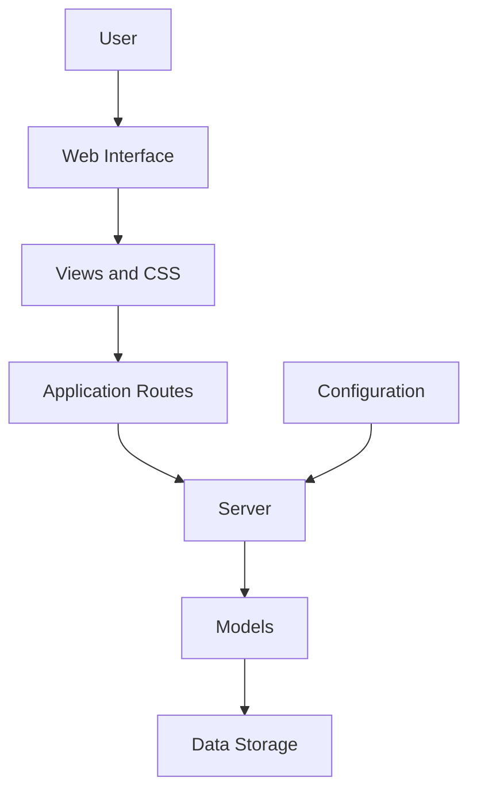

# 📦 Inventory Management System

## 📌 Project Overview

The Inventory Management System is a web-based application designed to simplify and organize inventory-related operations.

The application provides a structured platform for managing inventory information, organizing product records, and monitoring stock-related activities.

It aims to reduce manual inventory management efforts, improve data organization, and support efficient inventory tracking through a centralized web application.

---

## 🎯 Project Objectives

- Simplify inventory management operations.
- Maintain organized inventory records.
- Improve product and stock information management.
- Reduce manual record-keeping efforts.
- Provide a user-friendly interface for inventory-related activities.
- Support efficient inventory monitoring.

---

## 🏗️ System Architecture

The application follows a web-based architecture with separate configuration, data models, routing, presentation and server components.



---

## ⚙️ Key Modules

### 1. Configuration Management
- Maintains application configuration.
- Organizes settings required by the application.

### 2. Data Models
- Organizes the application's data structures.
- Defines how application records are represented.

### 3. Route Management
- Handles application routes.
- Connects user requests with application functionality.

### 4. User Interface
- Provides the web application interface.
- Uses HTML templates and CSS styling.

### 5. Server Management
- Initializes the application server.
- Coordinates application components.

### 6. Database Seeding
- Uses a seed script to initialize application data.

---

## 🔄 Application Workflow

1. **User Access:** The user accesses the inventory management application through the web interface.
2. **Request Handling:** Application requests are handled through the routing module.
3. **Data Processing:** The server coordinates the required application operations.
4. **Model Interaction:** Data models organize and manage application records.
5. **Response Generation:** The application processes the request and returns the appropriate response.
6. **User Interaction:** The user interacts with the resulting application interface.

---

## 🛠️ Technologies Used

| Category | Technology |
|---|---|
| Backend Runtime | Node.js |
| Programming Language | JavaScript |
| Frontend Styling | CSS |
| Package Management | npm |
| Application Server | Node.js |
| Version Control | Git and GitHub |

---

## 📁 Project Structure

```text
inventory-management-system/
│
├── config/
│
├── models/
│
├── node_modules/
│
├── public/
│   └── css/
│
├── routes/
│
├── views/
│
├── package-lock.json
├── package.json
├── seed.js
├── server.js
│
└── README.md
```

---
## 💻 Installation and Setup

### Prerequisites

- Node.js
- npm
- MongoDB
- Visual Studio Code

### Step 1: Clone the Repository

```bash
git clone https://github.com/kanishka1304/inventory-management-system.git
```

### Step 2: Navigate to the Project Directory

```bash
cd inventory-management-system
```

### Step 3: Install Dependencies

```bash
npm install
```

### Step 4: Configure MongoDB

Ensure MongoDB is running and configure the database connection in the appropriate configuration file.

### Step 5: Initialize Database

If the seed script is configured for your database:

```bash
node seed.js
```

### Step 6: Start the Application

```bash
npm start
```

### Step 7: Access the Application

Open your browser and navigate to the local URL configured in `server.js`.


---

## 📈 Expected Outcome

The Inventory Management System provides a centralized web-based approach to organizing inventory information and managing stock-related records.

The application aims to improve inventory organization, simplify operations, and provide a structured way to access inventory data.

---

## 🔮 Future Enhancements

- Real-time inventory tracking.
- Low-stock notifications.
- Automated stock alerts.
- Inventory analytics dashboard.
- Sales and purchase reports.
- Barcode-based product identification.
- Role-based access management.
- Advanced inventory forecasting.

